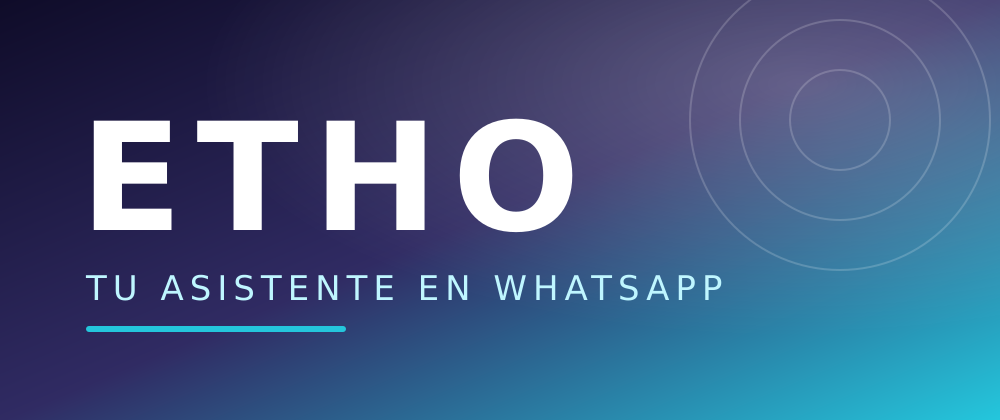
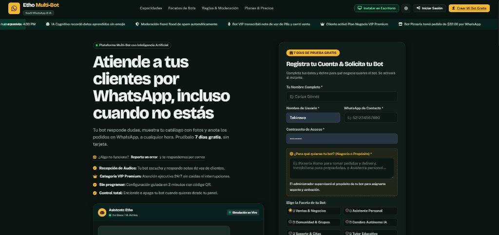
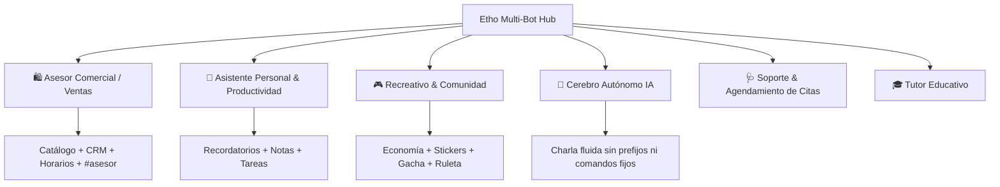

<p align="center">
  
</p>

<h1 align="center">🚀 ETHO MULTI-BOT HUB & EXECUTIVE SAAS DASHBOARD</h1>

<p align="center">
  <strong>Plataforma integral de WhatsApp empresarial y recreativo: Backend Multi-Instancia Baileys + Panel Web Reactivo SaaS + Inteligencia Artificial Cognitiva + Sincronización en la Nube con Supabase y SQLite Nativo.</strong>
</p>

<p align="center">
  <a href="https://nodejs.org/"></a>
  <a href="https://github.com/WhiskeySockets/Baileys"></a>
  <a href="https://supabase.com/"></a>
  <a href="https://stripe.com/"></a>
  <a href="https://expressjs.com/"></a>
</p>

---

## 📌 Tabla de Contenidos

- [🌟 Visión General](#-visión-general)
- [📸 Captura del Panel Ejecutivo](#-captura-del-panel-ejecutivo)
- [✨ Características Principales](#-características-principales)
- [🎭 Facetas y Especialidades de los Bots](#-facetas-y-especialidades-de-los-bots)
- [🛠️ Stack Tecnológico](#️-stack-tecnológico)
- [🏗️ Arquitectura del Sistema](#️-arquitectura-del-sistema)
- [🚀 Inicio Rápido](#-inicio-rápido)
  - [🪟 Windows (1 Clic)](#-windows-1-clic)
  - [🐧 Linux / macOS / Manual](#-linux--macos--manual)
  - [🐳 Docker / Docker Compose](#-docker--docker-compose)
- [🔑 Variables de Entorno (.env)](#-variables-de-entorno-env)
- [📱 Vinculación de WhatsApp](#-vinculación-de-whatsapp)
- [🧪 Pruebas y Diagnóstico](#-pruebas-y-diagnóstico)
- [☁️ Despliegue en la Nube](#️-despliegue-en-la-nube)
- [🤝 Soporte y Contribución](#-soporte-y-contribución)

---

## 🌟 Visión General

**Etho Multi-Bot Hub** es una solución de nivel empresarial diseñada para gestionar simultáneamente decenas de instancias independientes de WhatsApp desde una consola web centralizada. Diseñado tanto para negocios y comercio electrónico como para comunidades recreativas, combina automatización sin código, análisis de leads (CRM), catálogo de productos, procesamiento de notas de voz con Whisper y respuestas cognitivas con IA (Google Gemini / HuggingFace).

---

## 📸 Captura del Panel Ejecutivo

<p align="center">
  
  <br>
  <em>Portal de bienvenida, registro de clientes, gestión de bots y monitorización en tiempo real.</em>
</p>

---

## ✨ Características Principales

| Módulo | Descripción |
| :--- | :--- |
| **🏢 Dashboard SaaS Multi-Instancia** | Monitorea el estado, memoria RAM, actividad en vivo por SSE y logs de cada bot sin reiniciar el servidor. |
| **🧠 Inteligencia Artificial Multimodal** | Compatible con Google Gemini y Hugging Face; atiende mensajes de texto y notas de voz con transcripción automática. |
| **💼 CRM de Prospectos (Leads)** | Detección automática de números y correos interesados en productos, gestión por estados (*Nuevo, Contactado, Ganado*) y exportación en CSV/Excel. |
| **🛍️ Catálogo Digital Interactivo** | Envío de menús visuales con el comando `#catalogo`, fotos de productos, precios y enlaces de compra directa. |
| **⏱️ Horarios & Human Handoff** | Respuestas automáticas fuera de horario y transferencia a atención humana con `#asesor` pausando el bot temporalmente. |
| **⚡ Reglas Dinámicas Sin Código** | Crea disparadores personalizados con variables automáticas como `{user}`, `{name}`, `{date}`, `{time}` y `{bot}`. |
| **🛡️ Moderación Activa Anti-Spam** | Detección y bloqueo automático de enlaces externos, flood de mensajes y contenido inapropiado. |
| **🎮 Modo Recreativo (+219 Comandos)** | Economía virtual, apuestas, gacha de personajes de anime, creador de stickers y minijuegos sociales. |

---

## 🎭 Facetas y Especialidades de los Bots

Al crear una nueva instancia desde el panel, puedes elegir su personalidad y propósito:



---

## 🛠️ Stack Tecnológico

- **Entorno de Ejecución:** Node.js 22.13+ (ES Modules nativos).
- **Protocolo WhatsApp:** `@whiskeysockets/baileys` (Multi-instancia desacoplada).
- **Backend & API:** Express.js con compresión, CORS y Server-Sent Events (SSE).
- **Bases de Datos:**
  - **Local:** SQLite integrado con `node:sqlite` para velocidad sin dependencias externas pesadas.
  - **Cloud Mirror:** Supabase (PostgreSQL) para respaldos remotos y webhooks en vivo.
- **Frontend:** Single-Page Application (SPA) responsive en Vanilla JS, CSS3 con variables temáticas (Tema Pino/Caléndula y Dark Executive), compatible con PWA en móviles y escritorio.
- **IA & Media:** Google Gemini API, Hugging Face Hub (Whisper Audio) y FFmpeg estático.

---

## 🏗️ Arquitectura del Sistema

```
etho-bot-main/
├── assets/                  # Banners, capturas y recursos visuales
├── docs/                    # Guías de producción, pagos y despliegue
│   ├── DEPLOY.md            # Despliegue en Render, Railway, VPS y Docker
│   ├── PAYMENTS.md          # Pasarela Stripe y cobros manuales
│   └── PRODUCTION.md        # Lista de verificación pre-producción
├── scripts/                 # Scripts de test, comprobación y smoke test
├── src/
│   ├── index.js             # Entrada principal (servidor web + gestor de bots)
│   ├── server.js            # API REST, autenticación JWT/sesiones y SSE
│   ├── manager.js           # Orquestador multi-instancia Baileys
│   ├── handler.js           # Enrutamiento inteligente de mensajes y eventos
│   ├── db.js                # Capa SQLite + Sincronizador de Supabase
│   ├── commands/            # Módulos de comandos (admin, economía, gacha, etc.)
│   ├── lib/                 # Módulos de IA, calidad, alertas, planes y facturación
│   └── web/public/          # Interfaz web del Dashboard y landing comercial
├── supabase/
│   └── schema.sql           # Esquema relacional para PostgreSQL en Supabase
├── docker-compose.yml       # Orquestación de contenedores
├── Dockerfile               # Imagen optimizada de producción
└── iniciar.bat              # Lanzador en 1 clic para entornos Windows
```

---

## 🚀 Inicio Rápido

### 🪟 Windows (1 Clic)

Simplemente ejecuta el lanzador automático incluido en la raíz del proyecto:

```cmd
iniciar.bat
```

*El script comprobará Node.js, instalará las dependencias si faltan, encenderá el servidor y abrirá tu navegador automáticamente en `http://localhost:3000`.*

---

### 🐧 Linux / macOS / Manual

```bash
# 1. Clonar el repositorio
git clone https://github.com/TakizawaXD/etho-bot.git
cd etho-bot

# 2. Instalar dependencias
npm install

# 3. Configurar entorno
cp .env.example .env
# Edita las credenciales en .env según tus necesidades

# 4. Iniciar el hub
npm start
```

---

### 🐳 Docker / Docker Compose

```bash
# Levantar contenedor en segundo plano con persistencia
docker compose up -d --build
```

---

## 🔑 Variables de Entorno (.env)

Copia `.env.example` como `.env` y completa tus credenciales principales:

```env
# Servidor
PORT=3000
NODE_ENV=production
ADMIN_USERNAME=admin
ADMIN_PASSWORD=TuPasswordSeguro

# Bot Global
BOT_NAME=Etho
PREFIX=#

# Inteligencia Artificial
GEMINI_API_KEY=tu_api_key_de_google_ai_studio
HF_TOKEN=tu_token_de_huggingface

# Supabase en la Nube (Opcional)
SUPABASE_URL=https://tu-proyecto.supabase.co
SUPABASE_KEY=tu_api_key_supabase

# Pasarela de Pagos (Stripe Checkout)
STRIPE_SECRET_KEY=sk_live_...
STRIPE_WEBHOOK_SECRET=whsec_...
```

---

## 📱 Vinculación de WhatsApp

1. Ingresa al panel en **`http://localhost:3000`**.
2. Inicia sesión con tus credenciales de administrador.
3. Haz clic en **`+ Nuevo Bot`**, selecciona el nombre y la faceta deseada.
4. Presiona **`Escanear QR`** o solicita el código de 8 dígitos de vinculación directa.
5. Abre WhatsApp en tu celular:
   - **Ajustes / Configuración** > **Dispositivos vinculados** > **Vincular dispositivo**.
6. Apunta la cámara al código QR en pantalla: tu bot pasará de inmediato a estado **En Línea** 🟢.

---

## 🧪 Pruebas y Diagnóstico

El proyecto incluye un completo sistema de verificación automatizada:

```bash
# Validar estructura y ausencia de comandos duplicados
npm run check

# Ejecutar suite de pruebas (UI, IA, Billing, Planes y Rutas)
npm test

# Ejecutar smoke test contra el servidor en vivo
npm run smoke
```

---

## ☁️ Despliegue en la Nube

Para llevar el proyecto a producción con alta disponibilidad, revisa nuestras guías especializadas:

- 📖 **[Guía de Despliegue en Producción (DEPLOY.md)](docs/DEPLOY.md):** Instrucciones paso a paso para Railway, Render, VPS (Ubuntu/Debian) con PM2 y Docker.
- 💳 **[Configuración de Pagos y Suscripciones (PAYMENTS.md)](docs/PAYMENTS.md):** Integración de Stripe Webhooks, pagos con tarjeta y transferencias bancarias.
- 📋 **[Checklist de Producción (PRODUCTION.md)](docs/PRODUCTION.md):** Seguridad, cuotas, retención y monitoreo.

---

## 🤝 Soporte y Contribución

¿Encontraste algún problema o tienes una sugerencia?
- Reporta un issue en este repositorio: [https://github.com/TakizawaXD/etho-bot/issues](https://github.com/TakizawaXD/etho-bot/issues)
- Utiliza el módulo integrado de **Tickets de Soporte** directamente desde el Dashboard web.

<p align="center">
  Hecho con ❤️ para la comunidad de desarrolladores y negocios de WhatsApp.
  <br>
  <strong>© 2026 Etho Multi-Bot Hub. Todos los derechos reservados.</strong>
</p>
